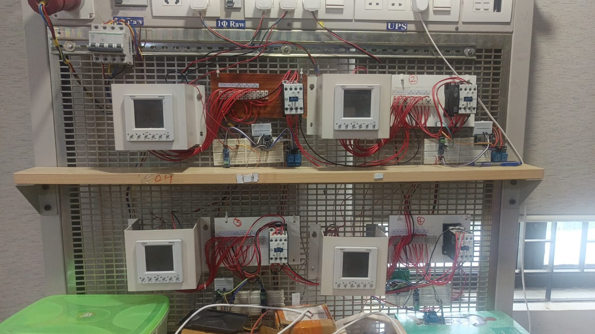

# Smart Grid Energy Monitoring

A hardware test rig that monitors a small multi-node electrical network. Several energy-meter nodes measure voltage, current and power on separate lines, and a central controller collects their readings, shows them on a live dashboard, and can switch each line on or off remotely.

Built as an exploration of how energy monitoring and supervisory control work in modern power distribution.

## Tech stack

ESP32 microcontrollers, industrial energy meters, embedded C/C++, web dashboard, cloud data logging.

## Photos

*The metering and switching rig.*

## Status

This project is part of ongoing patent and research work, so implementation details and source code are withheld here. Code can be shared on request.

---

Built by Sankalp Singh Bais.
